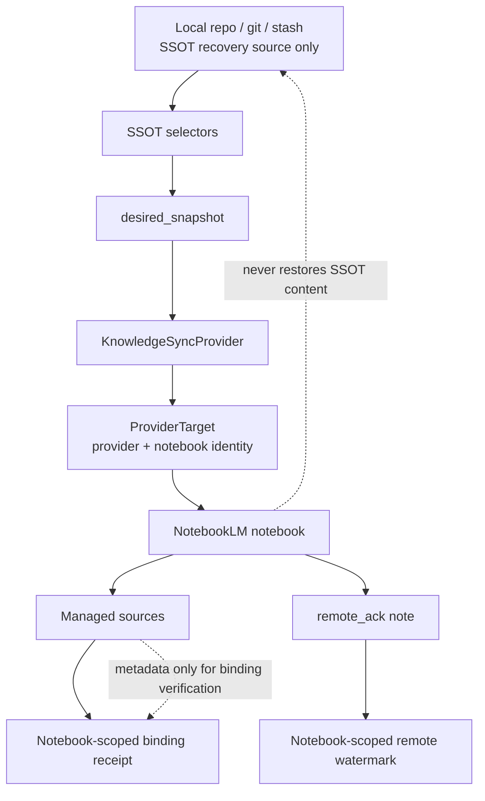
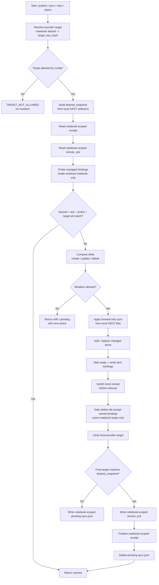
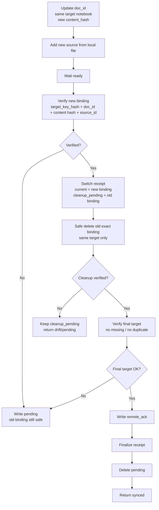

# Reply to Coding Agent: Phase 8 Sync Spec Corrections

**Status:** Direction accepted, implementation not approved until the corrections below are reflected in the Phase 8 spec.  
**Proposed final name:** `SSOT Snapshot Ack Sync + Notebook-Scoped Binding Receipt`  
**Audience:** Coding agent implementing Vibe Control Phase 8  
**Language policy:** Explanation in Chinese; code, config keys, filenames, schema keys, and command names in English.

---

## 1. 结论

你的反馈是对的：Phase 8 的核心方向可以落地，但现在还不能直接开工。我们采纳这些修正：

```text
1. remote_ack 不替代 per-doc binding receipt。
2. knowledge-sync.json 仍然必须保存 provider_source_id / binding identity。
3. probe 必须定义成 item-level identity + ready verification。
4. update 必须 add -> wait -> verify -> switch receipt -> cleanup old。
5. rebuild 这个词必须收窄为 binding reindex，绝不能表示从 NotebookLM 恢复 SSOT 文件。
```

但我再补一个关键点：

```text
只关联 source_id 不够。
我们还有 notebook 这个 provider target 层级。
配置文件里指定的是 notebook id / alias / allowlist。
所以所有 binding、ack、receipt、safe delete、probe 都必须是 notebook-scoped。
```

换句话说，Phase 8 不能只说：

```text
doc_id -> provider_source_id
```

必须说：

```text
(provider, provider_target/notebook, project_id, doc_id) -> provider_source_id
```

`source_id` 即使在 NotebookLM 内部可能全局唯一，我们的 contract 也不能依赖这个假设。Provider adapter 的安全边界必须把 `notebook` 当作 binding identity 的一部分。

---

## 2. 修正后的身份模型

### 2.1 层级关系



### 2.2 Provider target 必须显式建模

新增顶层概念：

```text
ProviderTarget
```

对 NotebookLMProvider 来说，它至少包含：

```json
{
  "provider": "notebooklm",
  "notebook_alias": "OPM-test",
  "notebook_ref_hash": "sha256:...",
  "auth_profile_hash": "sha256:...",
  "target_key_hash": "sha256:..."
}
```

说明：

```text
notebook_alias
  user-facing name, e.g. OPM-test.

notebook_ref_hash
  hash of resolved NotebookLM notebook id/ref. Raw ref should be redacted in reports.

auth_profile_hash
  optional but recommended when multiple Google profiles/accounts may exist.
  It prevents using a receipt created under another auth context.

target_key_hash
  canonical hash of provider + notebook_ref_hash + auth_profile_hash.
```

`target_key_hash` 应该参与所有状态文件和安全判断。

### 2.3 Binding key 不是 source_id

`provider_source_id` 是 binding 的一部分，但不是完整 binding identity。

推荐的 binding identity：

```json
{
  "provider": "notebooklm",
  "target_key_hash": "sha256:...",
  "project_id": "vibe-control",
  "sync_scope": "ssot_files",
  "doc_id": "vibe_control_v0_7_spec",
  "content_sha256": "sha256:...",
  "provider_source_id": "...",
  "source_id_hash": "sha256:...",
  "managed_name": "vibe__vibe-control__vibe_control_v0_7_spec",
  "upload_filename": "vibe__vibe-control__vibe_control_v0_7_spec__h__a1b2c3d4e5f6.md",
  "ready": true
}
```

硬规则：

```text
A source_id is safe only inside the resolved provider target that created or verified it.
```

如果当前命令解析出的 notebook target 和 receipt / ack 里的 `target_key_hash` 不一致：

```text
status -> TARGET_MISMATCH
sync/delete/cleanup -> fail closed
query -> do not claim synced
```

---

## 3. 状态文件修订

### 3.1 remote_ack 必须 notebook-scoped

`remote_ack` 存在于 NotebookLM notebook 中，但它仍然必须写明自己属于哪个 provider target。

```json
{
  "schema_version": 1,
  "provider_contract": "vibe.knowledge.provider.v1",
  "project_id": "vibe-control",
  "sync_scope": "ssot_files",
  "provider": "notebooklm",
  "target_key_hash": "sha256:...",
  "notebook_alias": "OPM-test",
  "notebook_ref_hash": "sha256:...",
  "snapshot_hash": "sha256:...",
  "item_count": 12,
  "item_hashes_hash": "sha256:...",
  "binding_hash": "sha256:...",
  "updated_at": "2026-07-13T00:00:00Z"
}
```

`remote_ack` 的语义：

```text
This exact provider target has acknowledged this SSOT snapshot.
```

它不是：

```text
This project is synced everywhere.
```

### 3.2 knowledge-sync.json 必须 notebook-scoped

`knowledge-sync.json` 仍是本地 generated receipt，但它不是普通 cache。它是 per-doc provider binding receipt。

```json
{
  "schema_version": 1,
  "project_id": "vibe-control",
  "sync_scope": "ssot_files",
  "provider": "notebooklm",
  "provider_target": {
    "notebook_alias": "OPM-test",
    "notebook_ref_hash": "sha256:...",
    "auth_profile_hash": "sha256:...",
    "target_key_hash": "sha256:..."
  },
  "snapshot_hash": "sha256:...",
  "binding_hash": "sha256:...",
  "items": {
    "vibe_control_v0_7_spec": {
      "path": "docs/project/VIBE_CONTROL_V0_7_SPEC.md",
      "content_sha256": "sha256:...",
      "provider_source_id": "...",
      "source_id_hash": "sha256:...",
      "managed_name": "vibe__vibe-control__vibe_control_v0_7_spec",
      "upload_filename": "vibe__vibe-control__vibe_control_v0_7_spec__h__a1b2c3d4e5f6.md",
      "ready": true,
      "synced_at": "2026-07-13T00:00:00Z"
    }
  },
  "cleanup_pending": []
}
```

状态目录也建议带上 target scope，避免同一 project 同时配置多个 notebook 时互相污染：

```text
~/.agents/state/vibe-control/<project-id>/<provider>/<target_key_hash>/knowledge-sync.json
~/.agents/state/vibe-control/<project-id>/<provider>/<target_key_hash>/pending-sync.json
```

如果保持旧路径兼容，也必须在文件内容里校验 `target_key_hash`。

### 3.3 pending-sync.json 也必须 notebook-scoped

```json
{
  "schema_version": 1,
  "project_id": "vibe-control",
  "sync_scope": "ssot_files",
  "provider": "notebooklm",
  "target_key_hash": "sha256:...",
  "notebook_alias": "OPM-test",
  "reason": "NOTEBOOKLM_UNAVAILABLE",
  "target_ref": "origin/main",
  "target_commit": "abc123",
  "pending_since": "2026-07-13T00:00:00Z",
  "next_action": "vibe knowledge retry --json"
}
```

如果配置切换到另一个 notebook，旧 pending 不能自动套用到新 target。

---

## 4. probe / ack / receipt 的可验证规则

### 4.1 Fast path synced 条件

`status` 可以走 fast path，但必须同时满足：

```text
1. desired_snapshot.snapshot_hash == remote_ack.snapshot_hash
2. current target_key_hash == remote_ack.target_key_hash
3. current target_key_hash == receipt.target_key_hash, if receipt exists
4. probe.target_key_hash == current target_key_hash
5. probe.item_count == desired_snapshot.item_count
6. probe.ready_item_count == desired_snapshot.item_count
7. probe.item_hashes_hash == desired_snapshot.item_hashes_hash
8. probe.binding_hash == remote_ack.binding_hash
9. no duplicate managed item
10. no missing managed item
```

如果只满足 `ack`，不满足 `probe`：

```text
status = drift
```

如果 notebook target 不一致：

```text
status = target_mismatch
mutation = forbidden
```

### 4.2 binding_hash 算法必须包含 target

推荐：

```text
binding_hash = sha256(canonical_json(sorted([
  {
    "target_key_hash": "...",
    "doc_id": "...",
    "content_sha256": "sha256:...",
    "source_id_hash": "sha256:...",
    "upload_hash": "sha12...",
    "ready": true
  }
])))
```

这样可以防止：

```text
same doc_id + same source title + wrong notebook
```

被误判为 synced。

### 4.3 Safe delete 条件

删除任何 provider source 前，必须同时满足：

```text
1. current provider target matches receipt target_key_hash
2. candidate source is observed inside the current notebook inventory
3. candidate source_id matches receipt-owned provider_source_id
4. candidate source identity matches doc_id + managed_name + upload hash, or exact receipt binding
5. candidate is not unmanaged
6. duplicate state is either resolved by exact receipt ownership or fail closed
```

不能删除：

```text
- source from a different notebook target
- source found only by title prefix
- source found only by managed_name heuristic
- source not present in receipt and not proven by approved binding reindex
- unmanaged user source
```

### 4.4 Binding reindex 的边界

我们接受只读 reindex，但名字和语义必须收紧：

```text
Allowed:
  provider metadata -> local provider binding receipt

Forbidden:
  provider content -> local SSOT files
  provider content -> registry/config
  provider ack -> desired_snapshot
```

所以 `rebuild` 如果保留，只能是别名：

```text
vibe knowledge rebuild = vibe knowledge reindex-bindings
```

并且必须在输出里写明：

```text
No SSOT content was restored from provider.
Only provider binding metadata was reindexed.
```

---

## 5. 修正后的主流程



---

## 6. Update lifecycle 必须保留现有安全顺序



这个顺序不能简化成：

```text
add -> wait -> delete old -> write receipt
```

因为那会在 source 已删除但新 binding 未持久化时制造不可恢复窗口。

---

## 7. Implementation scope

### Phase 8.0 必须做

```text
- desired_snapshot with snapshot_hash and item_hashes_hash
- ProviderTarget / target_key_hash
- notebook-scoped receipt
- notebook-scoped pending
- notebook-scoped remote_ack
- item-level probe contract
- binding_hash including target_key_hash
- status fast path: desired + target + ack + probe
- safe delete requiring same target and receipt ownership
- update lifecycle with receipt switch before cleanup
- reindex-bindings only for provider binding metadata
- tests for target mismatch, wrong notebook, missing receipt, duplicate, unmanaged, pending retry
```

### Phase 8.0 不做或延后

```text
- remote-to-local SSOT recovery
- source content recovery from NotebookLM
- RunJournal / SQLite / daemon
- auto-stash by default
- query default mutation
- broad dir selector
- real PDF binary identity unless adapter tests prove it
```

### 必须新增的测试

```text
1. Same doc_id and same source_id_hash under different target_key_hash is not synced.
2. Receipt target mismatch blocks cleanup.
3. Ack target mismatch blocks synced fast path.
4. Probe only lists sources inside configured notebook target.
5. Safe delete refuses source from another notebook target.
6. Reindex-bindings reconstructs source_id mappings only, never SSOT content.
7. Changing notebook config creates target_mismatch, not silent reuse of old receipt.
8. Remote ack missing in current notebook does not read ack from another notebook.
9. Pending file is scoped to provider target.
10. Raw notebook refs and raw source IDs are redacted in user-visible reports.
```

---

## 8. Final instruction to coding agent

Please revise the Phase 8 spec before implementation.

The desired final model is:

```text
Local SSOT snapshot
+ notebook-scoped provider target
+ per-doc binding receipt
+ provider-side ack watermark
+ forward-only sync
```

Do not implement a model where `source_id` alone proves ownership.

The minimum safe binding identity is:

```text
provider + target_key_hash + project_id + sync_scope + doc_id + content_sha256 + provider_source_id/source_id_hash
```

For NotebookLM specifically, `target_key_hash` must represent the resolved configured notebook identity, because the config chooses a notebook and all source operations happen inside that notebook target.

If target identity cannot be resolved or does not match receipt / ack:

```text
fail closed
report target_mismatch
perform no provider mutation
```

