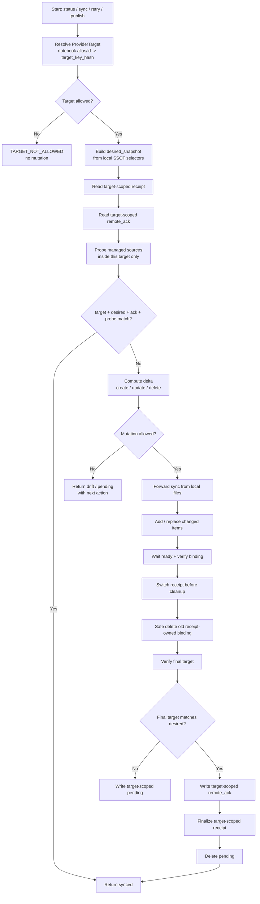

# Reply to Coding Agent: Phase 8 Core Scope and Notebook-Scoped Binding

**Status:** Accepted as the Phase 8 spec correction direction. Implementation should wait until these corrections are merged into the formal Phase 8 spec.  
**Proposed spec name:** `Phase 8: SSOT Snapshot Ack Sync + Notebook-Scoped Binding Receipt`  
**Audience:** Coding agent / repository maintainer  
**Language policy:** Explanation in Chinese; code, commands, config keys, filenames, schema keys, and error codes in English.

---

## 1. 结论

你的反馈是正确的。我们采纳核心纠偏，但不扩大 Phase 8.0 的实现范围。

Phase 8.0 的核心不是引入复杂状态系统，而是把已有单向同步模型补齐 5 个安全边界：

```text
1. ProviderTarget / notebook target scope
2. target-scoped binding receipt
3. target-scoped remote_ack
4. item-level probe based on metadata + upload filename hash
5. safe update/delete lifecycle with receipt switch before cleanup
```

最重要的新增判断：

```text
source_id alone is not enough.
```

对 NotebookLM 来说，`source_id` 必须落在某个 notebook target 内才有安全语义。我们的 binding identity 必须至少是：

```text
(provider, provider_target/notebook, project_id, sync_scope, doc_id) -> provider_source_id
```

即使 NotebookLM 内部的 `source_id` 可能全局唯一，Vibe 的 contract 也不能依赖这个假设。

---

## 2. 保留的核心方向

这些方向维持不变：

```text
1. Local repo / git / stash-protected workspace is the only SSOT source.
2. Provider / NotebookLM is forward-only sync target.
3. remote_ack is only a remote watermark, not truth.
4. knowledge-sync.json is a binding receipt, not business SSOT.
5. pending-sync.json is a retry marker, not a run log.
6. retry re-generates the latest local desired_snapshot and syncs final state only.
7. No RunJournal, no SQLite, no daemon, no operation replay engine.
8. No remote-to-local SSOT recovery.
```

需要修正的是：

```text
No remote-to-local SSOT recovery
```

不等于：

```text
Do not read provider metadata to reindex local binding receipt
```

允许：

```text
provider metadata -> local provider binding receipt
```

禁止：

```text
provider content -> local SSOT files
provider ack -> desired_snapshot
provider metadata -> registry/config edits
```

建议把旧的 `rebuild` 语义收窄为：

```text
reindex-bindings / repair binding receipt
```

如果 CLI 继续保留 `vibe knowledge rebuild`，文档必须明确：

```text
rebuild only reindexes provider bindings.
It never restores SSOT content from NotebookLM.
```

---

## 3. ProviderTarget 是 Phase 8.0 必需概念

### 3.1 最小定义

Phase 8.0 只需要这个最小 `ProviderTarget`：

```json
{
  "provider": "notebooklm",
  "notebook_alias": "OPM-test",
  "notebook_ref_hash": "sha256:...",
  "auth_profile_hash": null,
  "target_key_hash": "sha256:..."
}
```

`target_key_hash` 在 Phase 8.0 中按下面规则计算：

```text
target_key_hash = sha256(canonical_json({
  "provider": "notebooklm",
  "notebook_ref_hash": "sha256:..."
}))
```

### 3.2 `auth_profile_hash` 不进入 Phase 8.0 mismatch 判断

`auth_profile_hash` 先不要做复杂探针。

Phase 8.0 规则：

```text
auth_profile_hash = null
not part of target_key_hash
not used for TARGET_MISMATCH
```

未来只有在 provider adapter 能稳定、确定性地取得 auth profile identity 时，才把它加入 target identity。

原因：不稳定的 auth profile hash 会制造假 `TARGET_MISMATCH`，这不是 Phase 8.0 核心功能。

---

## 4. Target-scoped receipt / pending / ack

### 4.1 State path

建议 Phase 8.0 直接使用 target-scoped path：

```text
~/.agents/state/vibe-control/<project-id>/<provider>/<target_key_hash>/knowledge-sync.json
~/.agents/state/vibe-control/<project-id>/<provider>/<target_key_hash>/pending-sync.json
```

这只是多一层目录，不是复杂状态系统。它防止同一个 project 同时使用多个 notebook 时互相污染。

### 4.2 `knowledge-sync.json` 是 notebook-scoped binding receipt

`knowledge-sync.json` 仍然不提交、不人工维护、可重建，但它不是普通 cache。它是当前 provider target 的 per-doc binding receipt。

最小 schema：

```json
{
  "schema_version": 1,
  "project_id": "vibe-control",
  "sync_scope": "ssot_files",
  "provider": "notebooklm",
  "provider_target": {
    "notebook_alias": "OPM-test",
    "notebook_ref_hash": "sha256:...",
    "auth_profile_hash": null,
    "target_key_hash": "sha256:..."
  },
  "snapshot_hash": "sha256:...",
  "binding_hash": "sha256:...",
  "items": {
    "vibe_control_v0_7_spec": {
      "path": "docs/project/VIBE_CONTROL_V0_7_SPEC.md",
      "content_sha256": "sha256:...",
      "provider_source_id": "...",
      "source_id_hash": "sha256:...",
      "managed_name": "vibe__vibe-control__vibe_control_v0_7_spec",
      "upload_filename": "vibe__vibe-control__vibe_control_v0_7_spec__h__a1b2c3d4e5f6.md",
      "ready": true,
      "synced_at": "2026-07-13T00:00:00Z"
    }
  },
  "cleanup_pending": []
}
```

### 4.3 `pending-sync.json` 也必须 target-scoped

`pending-sync.json` 表示当前 provider target 没有同步成功，不是 project-global pending。

```json
{
  "schema_version": 1,
  "project_id": "vibe-control",
  "sync_scope": "ssot_files",
  "provider": "notebooklm",
  "target_key_hash": "sha256:...",
  "notebook_alias": "OPM-test",
  "reason": "NOTEBOOKLM_UNAVAILABLE",
  "target_ref": "origin/main",
  "target_commit": "abc123",
  "pending_since": "2026-07-13T00:00:00Z",
  "next_action": "vibe knowledge retry --json"
}
```

### 4.4 `remote_ack` 必须 target-scoped

`remote_ack` note 虽然天然存在于某个 NotebookLM notebook 内，但 schema 里仍然必须写入 target identity。

```json
{
  "schema_version": 1,
  "provider_contract": "vibe.knowledge.provider.v1",
  "project_id": "vibe-control",
  "sync_scope": "ssot_files",
  "provider": "notebooklm",
  "target_key_hash": "sha256:...",
  "notebook_alias": "OPM-test",
  "notebook_ref_hash": "sha256:...",
  "snapshot_hash": "sha256:...",
  "item_count": 12,
  "item_hashes_hash": "sha256:...",
  "binding_hash": "sha256:...",
  "updated_at": "2026-07-13T00:00:00Z"
}
```

`remote_ack` 的语义是：

```text
This exact provider target acknowledged this exact SSOT snapshot.
```

不是：

```text
This project is globally synced.
```

---

## 5. Legacy receipt migration

生产环境已有 flat path：

```text
~/.agents/state/vibe-control/<project-id>/knowledge-sync.json
```

Phase 8.0 必须支持安全迁移，但不能静默复用错 notebook 的 receipt。

规则：

```text
1. Resolve current ProviderTarget first.
2. If target-scoped receipt exists, use it.
3. Else if old flat receipt exists:
   - read it read-only
   - verify notebook_ref_hash / target_key_hash matches current target
   - if match: migrate or use once, then write target-scoped receipt
   - if mismatch: return TARGET_MISMATCH and fail closed
4. Never use old flat receipt to delete or cleanup sources in a different target.
```

`TARGET_MISMATCH` 行为：

```text
status -> report target_mismatch, not synced
sync/delete/cleanup -> fail closed
query -> do not claim NotebookLM is synced
```

---

## 6. Probe contract: do not read remote source contents

NotebookLM source list may not expose full content hash. Phase 8.0 must not require reading source body or re-downloading provider content.

Provider probe 的远程侧指纹来源必须是：

```text
1. managed_name
2. upload_filename sha12
3. source_id / source_id_hash
4. ready state from provider metadata / wait result
5. receipt comparison when available
```

The upload filename must continue to include local content fingerprint:

```text
{managed_name}__h__{sha12}.md
```

Example:

```text
vibe__vibe-control__vibe_control_v0_7_spec__h__a1b2c3d4e5f6.md
```

So probe verifies:

```text
current notebook target contains exactly the expected managed doc_ids,
with expected upload hash fingerprints,
ready status,
and provider source bindings.
```

It does not prove content by reading NotebookLM source body.

---

## 7. Fast-path `synced` conditions

Do not implement ack-only synced.

`knowledge status` may return `synced` only when all of these are true:

```text
1. resolved ProviderTarget is allowed by config
2. receipt target, remote_ack target, and current target match
3. desired_snapshot.snapshot_hash == remote_ack.snapshot_hash
4. desired_snapshot.item_hashes_hash == remote_ack.item_hashes_hash
5. provider probe sees exactly expected managed items inside current target
6. provider probe has no missing / duplicate / unready managed item
7. provider probe binding_hash == remote_ack.binding_hash
8. receipt is present and consistent, or status reports a repairable receipt warning without allowing mutation
```

Practical simplification for user-facing docs:

```text
synced = target + desired_snapshot + remote_ack + provider probe all match.
```

But implementation tests must cover the detailed conditions above.

---

## 8. `binding_hash` minimum algorithm

`binding_hash` should be deterministic and target-scoped.

Minimum input:

```json
[
  {
    "target_key_hash": "sha256:...",
    "doc_id": "vibe_control_v0_7_spec",
    "content_sha256": "sha256:...",
    "upload_hash": "a1b2c3d4e5f6",
    "source_id_hash": "sha256:...",
    "ready": true
  }
]
```

Algorithm:

```text
binding_hash = sha256(canonical_json(sorted_by_doc_id(items)))
```

Do not include raw source IDs in committed reports. `source_id_hash` is enough for reports and ack.

---

## 9. Safe update and delete lifecycle

### 9.1 Update order is mandatory

Correct update lifecycle:

```text
add new source from local SSOT file
-> wait ready
-> verify new binding identity
-> switch receipt: current = new binding, cleanup_pending = old binding
-> safe delete old receipt-owned binding
-> verify final provider target
-> write remote_ack
-> finalize receipt
-> delete pending-sync.json
```

Do not simplify this to:

```text
add -> wait -> delete old -> write receipt
```

That creates a dangerous window where the old source is gone but the new binding is not durably recorded.

### 9.2 Safe delete conditions

A provider source can be deleted only if all conditions hold:

```text
1. Current ProviderTarget matches receipt target.
2. Source is observed in the current notebook inventory.
3. Source_id matches receipt-owned binding or cleanup_pending binding.
4. doc_id matches expected managed identity.
5. upload filename hash matches expected old content hash.
6. Source is not unmanaged.
```

Never delete based only on:

```text
title prefix
managed name guess
filename heuristic without receipt/probe evidence
broad notebook cleanup
```

---

## 10. Multi-notebook behavior

Sync state is per target, not project-global.

Default behavior:

```text
vibe knowledge status --json
```

checks the configured default notebook target.

Other targets require explicit selection:

```bash
vibe knowledge status --notebook <alias> --json
vibe knowledge sync --notebook <alias> --apply --json
vibe knowledge query --notebook <alias> --question-file <file> --json
```

Rules:

```text
1. read_ack must first resolve the selected ProviderTarget.
2. read_ack must only read the ack note from that exact target.
3. Never scan another notebook to find a matching ack.
4. A project can be synced in target A and drift in target B.
5. Query may claim synced only for the selected/default target being checked.
```

---

## 11. Command mutation policy

Keep Phase 8.0 conservative.

| Command | May mutate provider by default? | Rule |
|---|---:|---|
| `vibe knowledge status` | No | read-only |
| `vibe knowledge diff` | No | read-only |
| `vibe knowledge query` | No | read-only by default; fallback or warn if not synced |
| `vibe knowledge sync --dry-run` | No | read-only plan |
| `vibe knowledge sync --apply` | Yes | explicit mutation |
| `vibe knowledge retry` | Yes | explicit retry mutation |
| `vibe spec publish` | Yes, after commit/push gate | bounded publish flow |
| `vibe doctor` | No | read-only unless explicitly flagged |
| `vibe knowledge rebuild` / `reindex-bindings` | No provider mutation by default | read provider metadata; write local receipt only |

`knowledge query` must not auto-mutate provider unless a future explicit config/flag enables it.

---

## 12. Phase 8.0 scope cut

Do not expand Phase 8.0 beyond the sync-state core.

### In Phase 8.0

```text
1. ProviderTarget / target_key_hash
2. target-scoped receipt and pending state
3. target-scoped remote_ack
4. desired_snapshot hash and item_hashes_hash
5. metadata + upload-filename based probe
6. safe update/delete lifecycle
7. binding reindex only; no SSOT recovery
8. status/diff/retry behavior
9. legacy receipt target mismatch handling
10. tests with fake provider and current NotebookLM adapter surface
```

### Defer to later phase

```text
auth_profile_hash detection
PDF / binary real-provider proof
broad dir selector
query auto mutation
auto-stash
new vibe ssot add command
complex daemon / scheduler / background sync
```

The SSOT selector contract can still mention future `file` / `dir` support, but implementation should not pretend all binary/PDF identity is proven until adapter tests cover it.

---

## 13. Minimal main flow



---

## 14. Tests required before implementation is accepted

Minimum TDD coverage:

```text
1. target_key_hash changes when notebook_ref_hash changes.
2. old flat receipt with matching target can migrate/use safely.
3. old flat receipt with mismatched target returns TARGET_MISMATCH.
4. status is not synced when ack matches but probe misses a source.
5. status is not synced when ack matches but source is in wrong notebook target.
6. status is not synced when duplicate managed source exists.
7. query does not auto-mutate provider by default when pending/drift.
8. update lifecycle switches receipt before deleting old source.
9. cleanup deletes only receipt-owned binding in current target.
10. reindex-bindings rebuilds local provider binding receipt only, never SSOT content.
11. remote_ack is read only after resolving the selected/default target.
12. multi-notebook: target A synced does not imply target B synced.
13. probe uses upload filename hash / metadata, not remote source body.
14. auth_profile_hash null does not trigger target mismatch in Phase 8.0.
```

---

## 15. Final acceptance decision

This feedback should be merged into the formal Phase 8 spec before coding starts.

Accepted final model:

```text
Phase 8: SSOT Snapshot Ack Sync + Notebook-Scoped Binding Receipt
```

Core sentence:

```text
Vibe builds a local SSOT snapshot, resolves exactly one provider target, syncs that target forward-only, records per-doc source bindings in a target-scoped receipt, and writes a target-scoped remote_ack only after the target is verified.
```

中文版本：

```text
本地 SSOT snapshot 决定要同步什么；
当前 provider target / notebook 决定同步到哪里；
receipt 记录每个 doc_id 在这个 target 里的 source binding；
remote_ack 记录这个 target 已确认到哪个 snapshot；
失败后永远从本地 snapshot 重新正向收敛。
```

Do not start coding until the formal Phase 8 spec replaces the older `desired corpus` / ack-only / broad rebuild language with the rules above.
