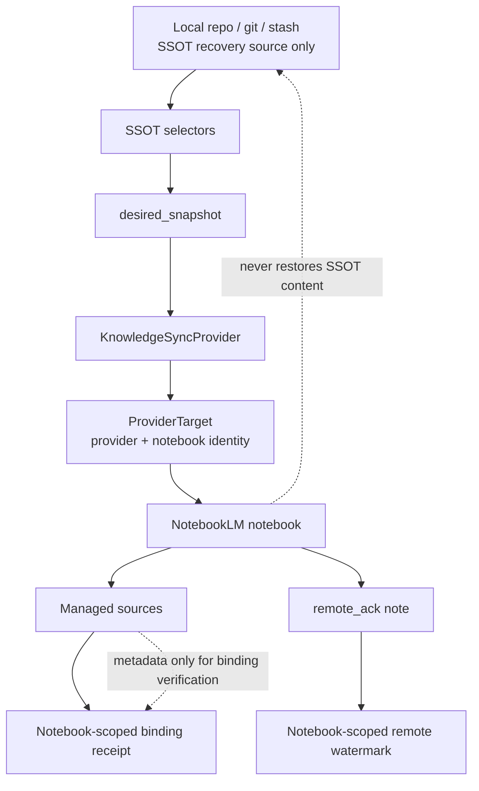

# Phase 8: SSOT Snapshot Ack Sync + Notebook-Scoped Binding Receipt

**Status:** Formal Phase 8.0 spec (implementation-ready)  
**Date:** 2026-07-14  
**Scope:** Vibe Control knowledge sync state model  
**Language policy:** Explanation in Chinese; code, commands, config keys, schemas, filenames, and interface names in English.

**Supersedes:** earlier candidate wording that allowed ack-only synced, broad rebuild, or source_id-only ownership.

**Correction sources:**

- `docs/project/sync/phase8-final-reply-to-coding-agent-core-scope.md`
- `docs/project/sync/phase8-coding-agent-reply-notebook-scoped-binding.md`

---

## 0. Core sentence

```text
Vibe builds a local SSOT snapshot, resolves exactly one provider target, syncs that target forward-only, records per-doc source bindings in a target-scoped receipt, and writes a target-scoped remote_ack only after the target is verified.
```

中文：

```text
本地 SSOT snapshot 决定要同步什么；
当前 provider target / notebook 决定同步到哪里；
receipt 记录每个 doc_id 在这个 target 里的 source binding；
remote_ack 记录这个 target 已确认到哪个 snapshot；
失败后永远从本地 snapshot 重新正向收敛。
```

Phase 8.0 completes five safety boundaries (not a new workflow engine):

```text
1. ProviderTarget / notebook target scope
2. target-scoped binding receipt
3. target-scoped remote_ack
4. item-level probe based on metadata + upload filename hash
5. safe update/delete lifecycle with receipt switch before cleanup
```

Hard rules retained:

```text
1. Local repo / git / stash-protected workspace is the only SSOT source.
2. Provider / NotebookLM is forward-only sync target.
3. remote_ack is only a remote watermark, not truth.
4. knowledge-sync.json is a binding receipt, not business SSOT.
5. pending-sync.json is a retry marker, not a run log.
6. retry regenerates the latest local desired_snapshot and syncs final state only.
7. No RunJournal, no SQLite, no daemon, no operation replay engine.
8. No remote-to-local SSOT content recovery.
```

Allowed vs forbidden recovery:

```text
Allowed:  provider metadata -> local provider binding receipt (reindex-bindings)
Forbidden: provider content -> local SSOT files
Forbidden: provider ack -> desired_snapshot
Forbidden: provider metadata -> registry/config edits
```

If CLI keeps `vibe knowledge rebuild`, it is an alias of reindex-bindings and must report:

```text
No SSOT content was restored from provider.
Only provider binding metadata was reindexed.
```

---

## 1. Layering



Binding identity is never `source_id` alone:

```text
(provider, provider_target/notebook, project_id, sync_scope, doc_id) -> provider_source_id
```

---

## 2. ProviderTarget

### 2.1 Phase 8.0 minimum

```json
{
  "provider": "notebooklm",
  "notebook_alias": "OPM-test",
  "notebook_ref_hash": "sha256:...",
  "auth_profile_hash": null,
  "target_key_hash": "sha256:..."
}
```

```text
target_key_hash = sha256(canonical_json({
  "provider": "notebooklm",
  "notebook_ref_hash": "sha256:..."
}))
```

### 2.2 auth_profile_hash deferred

```text
auth_profile_hash = null
not part of target_key_hash
not used for TARGET_MISMATCH in Phase 8.0
```

---

## 3. State files

### 3.1 Paths

```text
~/.agents/state/vibe-control/<project-id>/<provider>/<target_key_hash>/knowledge-sync.json
~/.agents/state/vibe-control/<project-id>/<provider>/<target_key_hash>/pending-sync.json
```

Legacy flat path (read-only migration source):

```text
~/.agents/state/vibe-control/<project-id>/knowledge-sync.json
```

### 3.2 Legacy migration

```text
1. Resolve current ProviderTarget first.
2. If target-scoped receipt exists, use it.
3. Else if old flat receipt exists:
   - read it read-only
   - verify notebook_ref_hash matches current target
   - if match: atomically migrate to scoped path (write scoped, then leave flat deprecated or remove)
   - if mismatch: TARGET_MISMATCH, fail closed
4. Never use old flat receipt to delete/cleanup sources in a different target.
```

### 3.3 remote_ack note naming

NotebookLM adapter stores ack as a managed note with stable identity:

```text
managed_name: vibe__{project_slug}__remote_ack
preferred title: vibe__{project_slug}__remote_ack
```

`read_ack` must resolve ProviderTarget first and only search that notebook. Never scan other notebooks for a matching ack.

### 3.4 Hash algorithms

```text
item_hashes_hash = sha256(canonical_json(sorted_by_doc_id([
  {"doc_id": "...", "content_sha256": "sha256:..."}
])))

snapshot_hash = sha256(canonical_json({
  "project_id": "...",
  "sync_scope": "ssot_files",
  "item_hashes_hash": "sha256:..."
}))

binding_hash = sha256(canonical_json(sorted_by_doc_id([
  {
    "target_key_hash": "...",
    "doc_id": "...",
    "content_sha256": "sha256:...",
    "upload_hash": "a1b2c3d4e5f6",
    "source_id_hash": "sha256:...",
    "ready": true
  }
])))
```

Do not include raw source IDs in committed reports.

---

## 4. Probe and synced fast path

Probe must not read remote source body. Remote fingerprints come from:

```text
managed_name
upload_filename sha12
source_id / source_id_hash
ready state from provider metadata
receipt comparison when available
```

Upload filename continues:

```text
{managed_name}__h__{sha12}.md
```

`synced` requires all of:

```text
1. resolved ProviderTarget is allowed by config
2. receipt target, remote_ack target, and current target match
3. desired_snapshot.snapshot_hash == remote_ack.snapshot_hash
4. desired_snapshot.item_hashes_hash == remote_ack.item_hashes_hash
5. probe sees exactly expected managed items inside current target
6. no missing / duplicate / unready managed item
7. probe.binding_hash == remote_ack.binding_hash
8. receipt is present and consistent with probe bindings
```

Receipt missing:

```text
status must NOT return synced
status may report receipt_missing with next_action=reindex-bindings or sync --apply
mutations that need ownership (delete/cleanup) fail closed until receipt exists or is reindexed
```

Ack-only synced is forbidden.

---

## 5. Update / delete lifecycle

```text
add new source from local SSOT file
-> wait ready
-> verify new binding identity
-> switch receipt: current = new binding, cleanup_pending = old binding
-> safe delete old receipt-owned binding
-> verify final provider target
-> write remote_ack
-> finalize receipt
-> delete pending-sync.json
```

Safe delete requires current target match, inventory observation, receipt/cleanup_pending ownership, managed identity + upload hash match, and not unmanaged.

---

## 6. Multi-notebook and mutation policy

Sync state is per target. Default commands use configured `default_alias`. Other targets need `--notebook <alias>`.

| Command | May mutate provider by default? |
|---|---:|
| `knowledge status` / `diff` | No |
| `knowledge query` | No (fallback/warn if not synced) |
| `knowledge sync --dry-run` | No |
| `knowledge sync --apply` | Yes |
| `knowledge retry` | Yes |
| `spec publish` | Yes after commit/push gate |
| `doctor` | No unless flagged |
| `rebuild` / `reindex-bindings` | Local receipt only by default |

---

## 7. Phase 8.0 scope

**In:** ProviderTarget, scoped receipt/pending/ack, snapshot hashes, metadata probe, safe lifecycle, reindex-bindings, status/diff/retry, legacy mismatch handling, fake-provider tests + adapter surface.

**Defer:** auth_profile_hash detection, PDF/binary proof, broad dir selector, query auto mutation, auto-stash, `vibe ssot add`, daemon/scheduler.

SSOT selectors may document future `file` / `dir`; Phase 8.0 implementation continues registry + `include_extra` compatibility.

---

## 8. Acceptance checklist

```text
1. target_key_hash changes when notebook_ref_hash changes.
2. old flat receipt with matching target migrates safely.
3. old flat receipt with mismatched target returns TARGET_MISMATCH.
4. status is not synced when ack matches but probe misses a source.
5. status is not synced for wrong notebook target.
6. status is not synced when duplicate managed source exists.
7. query does not auto-mutate provider by default when pending/drift.
8. update switches receipt before deleting old source.
9. cleanup deletes only receipt-owned binding in current target.
10. reindex-bindings never restores SSOT content.
11. remote_ack is read only after resolving selected/default target.
12. multi-notebook: target A synced does not imply target B synced.
13. probe uses upload filename hash / metadata, not remote body.
14. auth_profile_hash null does not trigger target mismatch.
15. receipt missing is not synced.
16. Unit + integration (fake provider) + acceptance-readonly gates pass.
17. No real NotebookLM mutation unless explicitly approved.
```

---

## 9. Naming

Prefer: SSOT files, SSOT selectors, SSOT snapshot, snapshot_hash, remote_ack, provider probe, forward sync, pending sync, ProviderTarget, target_key_hash, binding receipt, reindex-bindings.

Avoid as user-facing truth terms: desired corpus, redo log, run journal, remote rebuild (content), remote restore, workflow replay, ack-only synced.

---

## 10. Phase 8.0 Test Spec / Acceptance Contract

**Principle:** Test Spec is part of the spec. Implementation follows tests, not informal intent.

Default gates use **fake provider** or **read-only** paths. Real NotebookLM mutation is out of default unit/integration/acceptance.

Mutation column: `none` | `local-state-only` | `fake-provider` | `real-provider(explicit)`.

### 10.1 Provider target / notebook scope

| ID | Purpose | Fixture | Under test | Expected | Mutation | Failure mode |
|---|---|---|---|---|---|---|
| P8-TARGET-01 | `source_id` alone is never enough | two `ProviderTarget`s, same doc_id / source_id-like value | binding identity / status | different `target_key_hash` ⇒ not same binding; not synced across targets | none | cross-target ownership |
| P8-TARGET-02 | deterministic target key; auth deferred | provider + notebook_ref_hash; auth_profile_hash null vs set | `target_key_hash` | same hash; auth not in mismatch | none | unstable auth hash |
| P8-TARGET-03 | target mismatch fail-closed | receipt/ack for target A, resolve target B | status / sync-delete gate / query claim | `target_mismatch` or drift; mutation blocked; query not synced | none | silent reuse |

### 10.2 Target-scoped receipt / legacy

| ID | Purpose | Fixture | Under test | Expected | Mutation | Failure mode |
|---|---|---|---|---|---|---|
| P8-RECEIPT-01 | scoped paths | project + target | path helpers | `.../<provider>/<target_key_hash>/{knowledge-sync,pending-sync}.json` | none | flat path pollution |
| P8-RECEIPT-02 | legacy match migrate | flat receipt matching ref hash | `load_or_migrate_receipt` | migrate/use scoped | local-state-only | lose bindings |
| P8-RECEIPT-03 | legacy mismatch | flat receipt other notebook | migrate | `TARGET_MISMATCH`; no silent migrate; block mutation | none | wrong-notebook delete |
| P8-RECEIPT-04 | receipt_missing ≠ SSOT loss | no receipt; SSOT file present | status / reindex | not synced; reindex may run; SSOT bytes unchanged | local-state-only | remote restore |

### 10.3 Status fast path

| ID | Purpose | Fixture | Under test | Expected | Mutation | Failure mode |
|---|---|---|---|---|---|---|
| P8-STATUS-01 | synced requires full match | target+desired+ack+probe+receipt | `evaluate_sync_status` / CLI status | `sync_state=synced` | none | ack-only synced |
| P8-STATUS-02 | ack ok, probe missing | ack matches; probe misses item | status | drift, not synced | none | false synced |
| P8-STATUS-03 | duplicate managed | ack ok; two managed same doc | status | drift, not synced | none | ambiguous ownership |
| P8-STATUS-04 | unready item | ack ok; status not ready | status | pending/drift, not synced | none | race as synced |
| P8-STATUS-05 | pending marker | target-scoped `pending-sync.json` | status | `pending` unless explicit sync/retry verified | none | ignore pending |
| P8-STATUS-06 | provider unavailable | provider status/list fails | status | `unavailable`/`degraded`; no crash | none | exception crash |

### 10.4 Probe identity

| ID | Purpose | Fixture | Under test | Expected | Mutation | Failure mode |
|---|---|---|---|---|---|---|
| P8-PROBE-01 | fingerprint without body | upload_filename sha12 + metadata | `probe_managed_sources` | match without reading body | none | body download |
| P8-PROBE-02 | title/prefix insufficient for delete | title-only candidate | safe delete gate | refuse delete | none | heuristic delete |
| P8-PROBE-03 | hash canonicalization | permuted item lists | `item_hashes_hash` / `binding_hash` | order-independent via sorted doc_id | none | flaky hash |
| P8-PROBE-04 | binding includes target identity | binding rows | `binding_hash` | includes target_key_hash, doc_id, content_sha256, source_id_hash, upload_hash, ready | none | weak identity |

### 10.5 Remote ack

| ID | Purpose | Fixture | Under test | Expected | Mutation | Failure mode |
|---|---|---|---|---|---|---|
| P8-ACK-01 | resolve target before read | two notebooks; ack only in A | `read_ack` | only A's ack returned for A | none | cross-notebook scan |
| P8-ACK-02 | foreign ack ignored | ack from target B while on A | status | not synced | none | false synced |
| P8-ACK-03 | read-only cmds do not write ack | status/diff/query/doctor | CLI | no `write_ack` | none | accidental ack |
| P8-ACK-04 | write_ack after verify only | verified sync path | sync apply / lifecycle | ack written after final verify | fake-provider | early ack |
| P8-ACK-05 | ack semantics | ack schema | status | means this target acknowledged this snapshot | none | global synced claim |

### 10.6 Safe update lifecycle

| ID | Purpose | Fixture | Under test | Expected | Mutation | Failure mode |
|---|---|---|---|---|---|---|
| P8-LIFECYCLE-01 | receipt switch before delete | fake provider replace | replace lifecycle | order: add→wait→verify→switch→delete→verify→ack→finalize | fake-provider | delete before switch |
| P8-LIFECYCLE-02 | verify fail keeps old | add ok, verify fail | replace | old binding remains | fake-provider | orphan both |
| P8-LIFECYCLE-03 | cleanup fail keeps pending | switch ok, delete fail | replace | `cleanup_pending` retained | fake-provider | lose old id |
| P8-LIFECYCLE-04 | ack fail recoverable | cleanup ok, ack write fail | retry | next verify writes ack | fake-provider | stuck drift |
| P8-LIFECYCLE-05 | unmanaged never deleted | unmanaged remote source | cleanup/sync | unmanaged untouched | fake-provider | user data loss |

### 10.7 Pending / retry

| ID | Purpose | Fixture | Under test | Expected | Mutation | Failure mode |
|---|---|---|---|---|---|---|
| P8-PENDING-01 | failure writes pending | sync fail | pending writer | target-scoped pending exists | local-state-only | no retry signal |
| P8-PENDING-02 | retry rebuilds snapshot | SSOT changed while pending | retry | latest desired_snapshot | fake-provider | stale snapshot |
| P8-PENDING-03 | final snapshot only | five local edits while down | retry | one final sync, no history replay | fake-provider | RunJournal |
| P8-PENDING-04 | success clears pending | successful retry | retry | pending deleted | local-state-only | sticky pending |
| P8-PENDING-05 | no journal/sqlite/daemon | codebase / package surface | audit test | no RunJournal/SQLite/daemon required | none | scope creep |

### 10.8 CLI production wiring

| ID | Purpose | Fixture | Under test | Expected | Mutation | Failure mode |
|---|---|---|---|---|---|---|
| P8-CLI-01 | status uses evaluate path | fake/unavailable-safe fixture | `vibe knowledge status --json` | `sync_state` in synced/pending/drift/unavailable/target_mismatch | none | always synced=false stub |
| P8-CLI-02 | status read-only | mutation counters | status | no add/delete/ack write | none | status mutates |
| P8-CLI-03 | retry uses latest + pending | pending + changed SSOT | `knowledge retry` | recomputes snapshot; target-scoped pending | fake-provider | replay ops |
| P8-CLI-04 | sync --apply after verify | fake provider | `knowledge sync --apply` | scoped receipt + ack only after verify | fake-provider | ack before verify |
| P8-CLI-05 | query read-only default | not synced | `knowledge query` | repo fallback/warn; no auto provider mutation | none | silent auto-sync |

### 10.9 Reindex-bindings

| ID | Purpose | Fixture | Under test | Expected | Mutation | Failure mode |
|---|---|---|---|---|---|---|
| P8-REINDEX-01 | metadata → receipt | fake list sources | reindex | receipt rebuilt | local-state-only | noop |
| P8-REINDEX-02 | never writes SSOT/config | SSOT + registry present | reindex | file bytes unchanged | local-state-only | remote restore |
| P8-REINDEX-03 | no cross-target | metadata from other target | reindex | fail closed / empty for wrong target | none | cross bind |
| P8-REINDEX-04 | insufficient identity | unparseable titles only | reindex | fail closed | none | heuristic bind |

### 10.10 Mutation policy

| ID | Purpose | Fixture | Under test | Expected | Mutation | Failure mode |
|---|---|---|---|---|---|---|
| P8-MUTATION-01 | status/diff/query/doctor readonly | counters | CLI | no provider mutation | none | accidental mutate |
| P8-MUTATION-02 | apply/retry explicit | flags required | sync/retry | mutate only when invoked | fake-provider | dry-run mutates |
| P8-MUTATION-03 | default gates no real NLM | fast/serial/phase8 acceptance | harness | no real mutation flags | none | CI mutates |
| P8-MUTATION-04 | real mutation opt-in | separate acceptance | contract | requires explicit approval | real-provider(explicit) | silent real apply |

### 10.11 Gate mapping

```text
unit / integration (fake): P8-TARGET|RECEIPT|STATUS|PROBE|ACK|LIFECYCLE|PENDING|REINDEX|CLI|MUTATION (fake)
acceptance/phase8 readonly: spec phrases + pytest suite + no mutation flags (P8-MUTATION-03)
real NotebookLM: not part of Phase 8.0 default gates (P8-MUTATION-04)
```

### 10.12 Production wiring extensions

| ID | Purpose | Expected |
|---|---|---|
| P8-REAL-PROBE | Adapter probe uses `list_sources` metadata only | never `get_source` body; readonly |
| P8-ACK-NOTE | target-scoped ack read; write only on apply/retry/publish | status/query/doctor cannot write_ack |
| P8-APPLY-RETRY | sync --apply / retry use scoped receipt+pending+lifecycle | retry latest snapshot only; success clears pending |
| P8-REINDEX-CLI | `reindex-bindings` (+ `rebuild` alias) | receipt only; `ssot_restored=false` |

Phase 8.0 ack persistence:

```text
ack_store_kind=local_mirror
notebooklm_note_written=false
```

when NotebookLM native note CLI is unavailable. Local mirror fallback is acceptable and target-scoped, but status/apply JSON must expose this distinction and must never claim a NotebookLM remote note was written.

`synced` never relies on local mirror ack alone: desired_snapshot + target match + remote_ack watermark + provider probe of managed sources must all agree.
